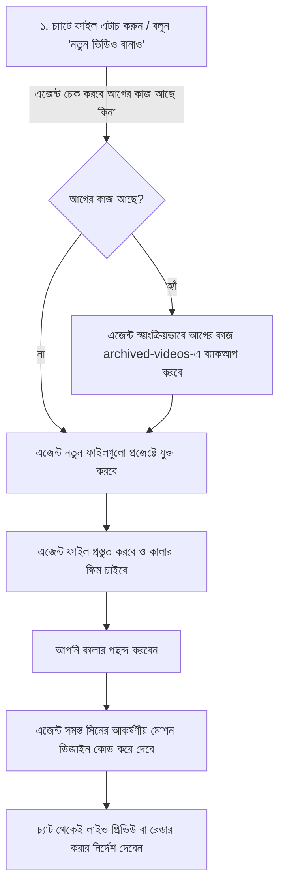

# 📘 নতুন ভিডিও তৈরির ধাপে ধাপে পূর্ণাঙ্গ গাইড (Step-by-Step Guide)
> কোডিং না জেনেও সরাসরি AI চ্যাট প্রম্পটের মাধ্যমে শুরু থেকে শেষ পর্যন্ত ভিডিও তৈরির নিয়ম।

---

## 🌟 পদ্ধতি ১: সরাসরি চ্যাট প্রম্পট ও মিডিয়া এটাচমেন্ট (সবচেয়ে সহজ ও রিকমেন্ডেড)

ভিএস কোড (VS Code) বা এন্টিগ্রাভিটি (Antigravity IDE)-এর চ্যাট প্রম্পট বক্সে **`+` (Add Context / Media)** বাটন রয়েছে। আপনাকে কোনো ফোল্ডার ওপেন করে ফাইল কপি-পেস্ট বা টার্মিনালে কমান্ড দিতে হবে না। সরাসরি চ্যাট থেকেই সবকিছু করা সম্ভব!



---

### চ্যাট প্রম্পটে সরাসরি কাজ করার নিয়ম:

#### ১. আগের ভিডিও আর্কাইভ করা (যখন ইচ্ছা):
আপনি যদি যেকোনো সময় আগের কাজ আর্কাইভ করতে চান, চ্যাটে শুধু লিখুন:
> 💬 *"আগের ভিডিও আর্কাইভ করে দাও"* অথবা *"আর্কাইভে মুভ করো"*

* **এজেন্ট কী করবে?**  
  এজেন্ট নিজে থেকেই ব্যাকগ্রাউন্ডে পুরো প্রজেক্টের ব্যাকআপ নিয়ে `archived-videos/` ফোল্ডারে তারিখসহ সংরক্ষণ করে দেবে এবং প্রজেক্ট ফাঁকা করে আপনাকে জানিয়ে দেবে।

#### ২. নতুন ভিডিও শুরু করা (ফাইল এটাচমেন্ট দিয়ে):
চ্যাট বক্সের নিচে বামে থাকা **`+` বাটন ➔ `Media`**-তে ক্লিক করে আপনার নতুন ভিডিওর ফাইলগুলো (যেমন: `voiceover.srt`, অডিও ফাইল, লোগো) সিলেক্ট করুন এবং প্রম্পটে লিখুন:
> 💬 *"এই কন্টেন্ট দিয়ে নতুন ভিডিও বানাও।"*

* **এজেন্ট স্বয়ংক্রিয়ভাবে নিচের কাজগুলো করবে:**
  1. **অটো-আর্কাইভ চেক:** আগে কোনো কাজ থাকলে এজেন্ট আগে সেটিকে `archived-videos/`-এ নিরাপদে সরিয়ে ব্যাকআপ রাখবে।
  2. **অটো-ফাইল প্লেসমেন্ট:** আপনার এটাচ করা `.srt` এবং অডিও নিজে থেকেই প্রজেক্টের সঠিক ফোল্ডারে সেট করে নেবে।
  3. **অটো-প্রিপারেশন:** ব্যাকগ্রাউন্ডে টাইমিং ও অডিও সিঙ্ক প্রস্তুত করবে।
  4. **কালার প্রস্তাবনা:** আপনার স্ক্রিপ্ট পড়ে ৪–৬টি আকর্ষণীয় কালার প্যালেট প্রস্তাব করবে এবং আপনার পছন্দের রঙ জানতে চাইবে।

#### ৩. রঙ নির্বাচন ও সিন জেনারেশন:
এজেন্টের কালার অপশন দেখে আপনি শুধু বলবেন:
> 💬 *"২ নম্বর কালার স্কিমটা নাও এবং রিল ফরম্যাটে বানিয়ে দাও।"*

* এজেন্ট স্বয়ংক্রিয়ভাবে সমস্ত সিনের চোখধাঁধানো মোশন গ্রাফিক্স, টাইপোগ্রাফি ও সাউন্ড ইফেক্টস কোড করে দেবে।

#### ৪. লাইভ প্রিভিউ দেখা ও ফাইনাল রেন্ডার:
ডিজাইন শেষে চ্যাটেই বলুন:
> 💬 *"লাইভ প্রিভিউ ওপেন করো"* (স্টুডিও চালু হবে)  
> 💬 *"ভিডিওটা MP4-এ রেন্ডার করো"* (এজেন্ট রেন্ডার চালিয়ে `generated-videos/video.mp4` বানিয়ে দেবে)

---

## 💻 পদ্ধতি ২: টার্মিনাল কমান্ড দিয়ে ম্যানুয়াল পদ্ধতি (বিকল্প)

আপনি যদি নিজে টার্মিনালে কমান্ড দিয়ে কাজ করতে পছন্দ করেন, তবে নিচের ধারাবাহিক ধাপগুলো অনুসরণ করুন:

| ধাপ | করণীয় | টার্মিনাল কমান্ড | কী ঘটবে? |
| :---: | :--- | :--- | :--- |
| **১** | ফ্রেশ শুরু | `npm run new-video` | আগের কাজ `archived-videos`-এ সেভ হবে |
| **২** | ফাইল দেওয়া | `input-content/` এ SRT ও অডিও ড্রপ করুন | ভিডিওর স্ক্রিপ্ট ও অডিও প্রস্তুত |
| **৩** | ফাইল প্রিপেয়ার | `npm run prepare-video` | টাইমিং সিঙ্ক ও অটো-ড্রাফট তৈরি হবে |
| **৪** | ডিজাইন তৈরি | চ্যাটে বলুন: *"সিনগুলো ডিজাইন করে দাও"* | এআই কালার দিয়ে সিন বানাবে |
| **৫** | লাইভ প্রিভিউ | `npm run studio` | ব্রাউজারে লাইভ ভিডিও প্লে করে দেখতে পারবেন |
| **৬** | ভিডিও রেন্ডার | `npm run render-video` | `generated-videos/video.mp4` ফাইল তৈরি হবে |
| **৭** | ভিডিও নেওয়া | `video.mp4` এ Right-Click ➔ *Reveal in File Explorer* | উইন্ডোজ ফাইল ফোল্ডারে ভিডিও পাবেন |

---

## 🎬 তৈরি হওয়া ভিডিও কোথায় পাবেন?

রেন্ডার হওয়া ভিডিওটি সর্বদাই এই লোকেশনে জমা থাকবে:
```
motion-graphics-engine/
└── generated-videos/
    └── video.mp4   ← 🎬 আপনার ফাইনাল ভিডিও!
```
উইন্ডোজ ফাইল এক্সপ্লোরারে সরাসরি দেখতে: `D:\SaaS-Web-Apps\motion-graphics-engine\generated-videos\`

---
*আপনার ভিডিও তৈরির সুবিধার্থে সিস্টেমটি এখন সম্পূর্ণ স্বয়ংক্রিয় ও চ্যাট-নির্ভর করে দেওয়া হয়েছে!*
